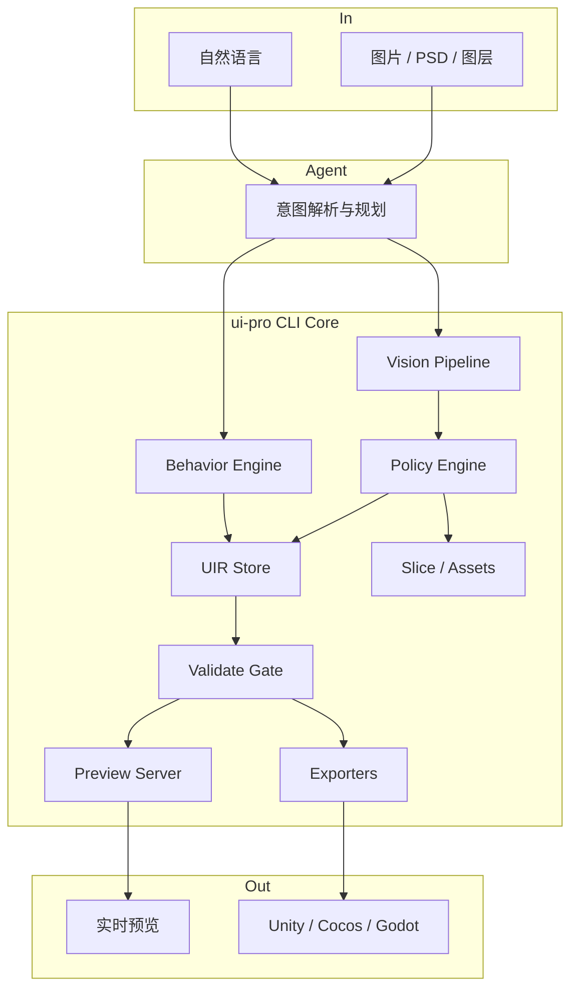
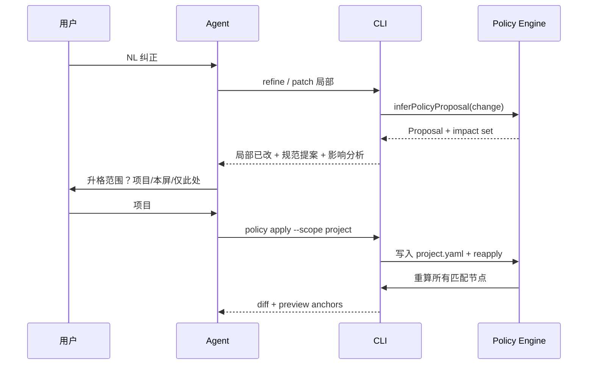

# UI-Pro 完整设计方案

> 游戏 UI 智能拆分 · 规范驱动 · 自然语言编排 · 实时预览 · 多引擎导出  
> 形态：**CLI 内核 + 大模型 Agent 编排**  
> 版本：v1.0 | 日期：2026-11-25

---

## 0. 文档导读

| 章节 | 内容 |
|------|------|
| [1](#1-愿景与成功标准) | 愿景、用户、商用成功标准 |
| [2](#2-设计原则) | 不可违背的产品与工程原则 |
| [3](#3-核心概念三件套) | **UIR + Policy + Behavior** |
| [4](#4-系统架构) | 模块、seam、数据流 |
| [5](#5-uir-场景中间表示) | 节点类型、溯源、工程结构 |
| [6](#6-policy-规范体系) | 决策层级、通用默认包、升格、一致性引擎 |
| [7](#7-behavior-行为体系) | 声明式交互与资源绑定 |
| [8](#8-cli-命令面) | Agent 可调用的深接口 |
| [9](#9-视觉分析与切分管线) | 分析阶段、切分、文本策略 |
| [10](#10-实时预览) | Web 预览与热更新 |
| [11](#11-引擎导出) | Unity / Cocos / Godot Adapter |
| [12](#12-agent-协作协议) | Skill 硬约束与人机流程 |
| [13](#13-通用性与品类扩展) | 模式库、模板、与 Policy 的关系 |
| [14](#14-质量门禁与可复现) | validate、锁文件、回归集 |
| [15](#15-示例全流程糖果骑士) | 用附件 UI 走通规范驱动路径 |
| [16](#16-技术选型与仓库结构) | 实现建议 |
| [17](#17-分期路线图) | Phase 0–4 |
| [18](#18-风险与对策) | 主要风险 |
| 附录 | Schema / Default Pack 索引 |

**配套文件：**

- [`packs/default.policy.yaml`](./packs/default.policy.yaml) — 产品自带通用规范包  
- [`schemas/overview.md`](./schemas/overview.md) — UIR / Policy / Behavior 字段总览  

---

## 1. 愿景与成功标准

### 1.1 一句话

把一张（或多张）游戏 UI 图，变成 **有明确指导原则、可预览、可自然语言修订、可导出到游戏引擎** 的结构化 UI 工程。

### 1.2 角色分工

| 角色 | 职责 |
|------|------|
| 用户 | 提供素材、表达意图、确认规范升格、定稿 |
| 大模型 Agent | 理解画面与自然语言、规划、把意图编译为 CLI 调用 |
| CLI | 全部确定性能力：分析、规范应用、切图、校验、预览、导出 |

### 1.3 要解决的真问题

今日常见路径是：美术出图 → 人工切图 → 引擎里摆控件 → 手写交互。痛点是：

1. 切分标准因人而异（有的红点独立切，有的烙在按钮上）  
2. 用户纠正是「一次性劳动」，不会沉淀为项目规范  
3. 预览与导出脱节，改完要进引擎才知道对不对  
4. 工具若绑死某品类（如只懂角色页），换背包/商店即失效  

### 1.4 商用成功标准（可验收）

| 指标 | 目标 |
|------|------|
| 结构变更均可追溯到 Policy ID | 100%（无「无主」节点决策） |
| 同类语义节点切分策略一致 | `policy check` 零违规才允许 export |
| 用户纠正升格为规范后，同屏/同项目自动重算 | 一次确认即可 |
| 默认包不依赖品类词（无「英雄」「装备」硬编码） | Default Pack 仅使用通用 UI 语义 |
| 示例「糖果骑士」人工修正次数 | ≤ 5 次可达可导出 |
| NL 变更到预览可见 | ≤ 1s（本地热更新） |
| 换一张异品类 UI（背包/商店） | 无需改 CLI；仅可选 template 建议 |

---

## 2. 设计原则

1. **规范驱动（Policy-Driven）**  
   一切切分、命名、交互默认行为由明确规则决定；模型临场发挥不得作为最终决策。

2. **三件套为唯一真相源**  
   `scene.uir.json` + `policy/*.yaml` + `behavior/*`；预览与导出只消费它们。

3. **CLI 深、Agent 浅**  
   命令少、行为多；Agent 只学稳定命令面，复杂策略藏在实现里。

4. **纠正即立法**  
   用户对实例的纠正，默认提升为「规范修订提案」，再决定作用域（一处 / 本屏 / 项目）。

5. **默认即可一致**  
   未开口时，Default Policy Pack 已保证全局一致；用户开口是改规范，不是改运气。

6. **品类无关的语义层**  
   节点与规则使用 Button / Badge / Slot / Tab / List…；品类词只出现在可选 Template 的「建议层」。

7. **人在环路**  
   低置信、规范冲突、升格提案必须可确认；禁止静默猜完就导出。

8. **可预览、可回滚、可复现**  
   每次变更有 patch/快照；模型与规则版本写入 lock。

---

## 3. 核心概念：三件套

```text
┌─────────────────────────────────────────────────────────┐
│  Policy（规范）  决定「应该怎么做」                        │
│  通用默认包 + 项目覆盖 + 屏幕覆盖 + 节点例外               │
└──────────────────────────┬──────────────────────────────┘
                           │ 物化 / 重算
                           ▼
┌─────────────────────────────────────────────────────────┐
│  UIR（场景）  描述「现在是什么结构」                       │
│  节点树、几何、切图引用、decidedBy 溯源                    │
└──────────────────────────┬──────────────────────────────┘
                           │ 绑定
                           ▼
┌─────────────────────────────────────────────────────────┐
│  Behavior（行为）  描述「运行时做什么」                    │
│  触发器 + 动作；预览与引擎导出共用语义                     │
└─────────────────────────────────────────────────────────┘
```

**一句话关系：** Policy 生成并约束 UIR；Behavior 挂在 UIR 节点/组上；三者版本化进工程。

---

## 4. 系统架构



### 4.1 模块与 Seam（深模块）

| 模块 | 对外接口 | 内部可替换实现 |
|------|----------|----------------|
| `vision` | `analyze(image) → Proposal` | 云端 VLM / 本地分割 |
| `policy` | `resolve / propose / apply / check / reapply` | YAML 规则引擎 |
| `uir` | `load / patch / query / tree` | JSON + JSON Patch |
| `slice` | `materialize(uir, policy) → assets` | OpenCV / SAM |
| `behavior` | `add / bind / list` | DSL → 行为图 |
| `preview` | `serve` + 热更新 | Pixi / Phaser |
| `export` | `export(target)` | 各引擎 Adapter |
| `history` | `snapshot / revert` | 文件快照 |

### 4.2 决策禁止项

- 禁止在未引用 Policy 的情况下直接写入结构性 UIR 字段（`sliceMode`、是否拆子节点、文本策略等）  
- 禁止 Exporter 内藏「再切一刀」逻辑；导出只翻译，不立法  
- 禁止 Default Pack 出现品类专有名词作为 `when` 条件  

---

## 5. UIR 场景中间表示

### 5.1 工程目录

```text
<project>/
  project.json                 # 设计分辨率、预览、导出偏好
  policy/
    default.lock.json          # 锁定使用的内置包版本
    project.yaml               # 项目级规范（覆盖默认）
    screens/
      character.yaml           # 可选：单屏覆盖
  scene.uir.json               # 场景真相源
  behaviors/
    main.beh.yaml
  source/
    ui.png
  assets/
    slices/
    atlas/
  preview/                     # 缓存
  export/
  history/
  ui-pro.lock.json             # 工具/模型/规则版本锁
```

### 5.2 通用节点类型（品类无关）

| 类型 | 含义 | 示例（糖果骑士，仅说明） |
|------|------|-------------------------|
| `Screen` | 根画布 | 整页 |
| `Group` | 逻辑分组 | 装备区、顶栏 |
| `Image` | 静态图 | 背景云、立绘、底座 |
| `Button` | 可点击 | 返回、升级、一键装备、货币「+」 |
| `Badge` | 角标/附着标记 | 红点、`+5` |
| `Slot` | 可替换内容槽 | 装备格（不叫 EquipSlot 也可，语义用 semantics） |
| `TabBar` / `Tab` / `Panel` | 互斥页签 | 属性/技能/天赋 |
| `List` / `ListItem` | 重复行 | 属性行 |
| `ProgressBar` | 进度 | 属性条 |
| `Text` | 动态或静态文本 | Lv、数值 |
| `CurrencyDisplay` | 图标+数值+可选操作 | 金币/钻石条 |
| `Title` | 标题区 | 「角色」艺术字标题 |
| `Avatar` | 角色/头像展示位 | 中央立绘（通用名，非 Hero） |

> 命名以 **UI 控件语义** 为准。`semantics.role` / `semantics.tags` 可补充业务含义（`notification`, `enhancement`, `currency.gold`），供 Policy 匹配，仍不绑死品类。

### 5.3 节点必备字段（摘要）

```json
{
  "id": "badge_upgrade_notify",
  "type": "Badge",
  "name": "升级通知红点",
  "rect": { "x": 860, "y": 1680, "w": 36, "h": 36 },
  "zIndex": 50,
  "parent": "btn_upgrade",
  "attach": { "anchor": "top_right", "offset": { "x": -8, "y": 8 } },
  "interactive": false,
  "visual": {
    "slice": "assets/slices/badge_upgrade_notify.png",
    "sliceMode": "independent"
  },
  "semantics": {
    "role": "notification",
    "shape": "dot"
  },
  "confidence": 0.93,
  "decidedBy": [
    "badge.notification.independent_slice@project"
  ]
}
```

**`decidedBy`**：商用审计字段。每个结构性决策必须能指出规则 ID + 作用域。

### 5.4 Proposal（分析未确认态）

`analyze` 不直接写死最终切图，先产出 Proposal：框、类型假说、建议命中的 Policy、置信度。用户/Agent `accept` 后，经 Policy Engine **物化** 为 UIR + assets。

---

## 6. Policy 规范体系（本方案的脊梁）

### 6.1 四层作用域与优先级

```text
高  Node Exception     用户显式「仅这一处」+ 必填 rationale
    Screen Policy      policy/screens/<id>.yaml
    Project Policy     policy/project.yaml
低  Default Pack       产品内置通用包（可锁版本，可禁用单条）
```

**L0 元原则（写死在引擎，不开放业务乱改）：**

1. 结构性决策必须来自某条 Policy  
2. 同 `when` 匹配的节点必须得到同 `then`（除非有 Exception）  
3. 用户纠正默认生成 Policy Proposal，而不是静默单点特判  
4. Default Pack 只使用通用 UI 语义谓词  
5. 冲突时按作用域优先级；同级按 `salience` 数值  

### 6.2 规则结构

```yaml
id: badge.notification.independent_slice
version: 1
salience: 100
enabled: true
title: 通知类角标独立切图
description: >
  通知红点/感叹号等 Badge 不得烘焙进父控件切图，
  必须作为独立节点附着在父节点角上。

when:
  all:
    - type: Badge
    - semantics.role: notification

then:
  slicing: independent          # independent | baked | inherit
  attach:
    anchor: top_right
    offset: { x: -8, y: 8 }
  export:
    sprite: separate
  naming:
    pattern: "badge_{parent_id}_notify"

meta:
  category: slicing             # slicing | structure | text | naming | interaction_default
  universal: true               # 默认包必须为 true
```

### 6.3 通用匹配谓词（保证自带规则通用）

Default Pack **允许**使用的条件：

- `type` / `type.in`  
- `semantics.role` / `semantics.tags`  
- `visual.traits`（如 `has_nine_slice_candidate`, `is_repeated`）  
- `pattern.kind`（`grid` | `list` | `tabs`）  
- `geometry`（角附着、嵌套于 Button 右上等）  
- `text.kind`（`numeric` | `label` | `art`）  
- `confidence.op`  

Default Pack **禁止**使用的条件：

- 品类词：`hero` / `equip` / `inventory` / `gacha` … 作为硬条件  
- 具体文案：`label == "升级"`  
- 单一项目坐标写死  

业务项目可以在 `project.yaml` 里写更贴业务的 `when`（例如 `semantics.tags` 含 `equip`），那是项目层，不是产品默认层。

### 6.4 产品自带 Default Pack 的设计目标

自带规则必须同时满足：

1. **跨品类**：RPG 角色、塔防 HUD、超休养成、SLG 弹窗都能用同一套  
2. **跨风格**：卡通糖果风、写实、像素风只影响视觉，不影响规则谓词  
3. **可关闭/可覆盖**：项目可 `disable` 某条默认，或提高 salience 覆盖  
4. **可解释**：`policy explain --node` 能说出命中规则  

完整清单见 [`packs/default.policy.yaml`](./packs/default.policy.yaml)，分类如下：

| 类别 | 示例规则意图 |
|------|----------------|
| 切分 | 通知 Badge 独立；强化数字角标默认子节点；货币「+」独立按钮 |
| 结构 | 重复单元识别为 List/Grid；Tab 互斥结构 |
| 文本 | 纯数字 → Text；艺术字标题默认留图；货币数值 → Text |
| 命名 | 稳定 id 模式；组名来自 pattern |
| 交互默认 | Button 具备 pressed 态槽位；Slot 具备 empty/filled |
| 导出 | 大横条按钮尝试九宫；装饰背景可合并 |

### 6.5 纠正 → 立法（核心体验）

用户：*「升级按钮右上角的红点要独立拆分。」*



**升格选项语义：**

| 选项 | 写入位置 | 后续行为 |
|------|----------|----------|
| 项目 | `policy/project.yaml` | 全项目 `reapply`；未来新屏 analyze 直接遵守 |
| 本屏 | `policy/screens/<screen>.yaml` | 仅该屏重算 |
| 仅此处 | 节点 `exceptions[]` | 必须写 `rationale`；`policy check` 仍通过但会在报告中列出例外 |

### 6.6 一致性引擎 API

```bash
ui-pro policy list [--scope default|project|screen]
ui-pro policy explain --node <id>
ui-pro policy propose --from-last-change
ui-pro policy apply <rule-id-or-file> --scope project|screen
ui-pro policy disable <rule-id>
ui-pro policy check                 # 违规 → 非零退出
ui-pro policy reapply [--dry-run]   # 按规范重切/重挂结构
```

`policy check` 失败示例：

```text
VIOLATION badge.notification.independent_slice
  node: btn_mail (baked notification pixels detected)
  fix: ui-pro policy reapply --rule badge.notification.independent_slice
```

### 6.7 与「默认也不能乱」的关系

- 出厂：`badge.notification.independent_slice` **默认启用**  
- 因此即使用户从未说话，所有通知红点已一致独立切  
- 用户那句话在「默认已独立」的项目里，可能变成：确认规则、微调 anchor/命名，或从「曾被错误烘焙」的实例中修复并 reapply  
- 若某项目禁用了该默认，用户纠正则会提案 **重新启用或项目级覆盖**  

---

## 7. Behavior 行为体系

### 7.1 定位

Behavior 描述运行时意图；**不**描述切分。切分属 Policy。

### 7.2 DSL 示例

```yaml
version: 1
bindings:
  - id: avatar_idle
    targets: ["avatar_main"]
    trigger: { type: onAppear }
    actions:
      - { type: playAnim, clip: "idle", loop: true }

  - id: slot_change_feedback
    targets: { group: "pattern.slots_grid" }
    trigger: { type: event, name: "contentChanged" }
    actions:
      - { type: playVFX, preset: "swap", attach: self }
      - { type: playAudio, clip: "sfx_ui_equip" }
```

### 7.3 与 Policy 的分工

| 事项 | 归属 |
|------|------|
| 红点是否独立节点 | Policy |
| 红点显隐动画是否默认挂上 | Policy 可提供 `interaction_default` 建议 |
| 「换装时特效+音效」 | Behavior（可批量 target group） |
| 导出到 Unity Particle | Exporter 映射 Behavior opcode |

### 7.4 NL → Behavior

「选中所有装备框，更换装备时要有特效和音效」：

1. `query` 解析到 `pattern`/`group`（通用：`Slot` 网格，而非写死 equip）  
2. 若资源缺失 → 创建 placeholder + TODO，不阻断预览  
3. 写入 behavior，preview 热更新  

---

## 8. CLI 命令面

### 8.1 设计约束

- 每命令 stdout：**JSON**（`--json` 默认对 Agent）+ 可选人类 summary  
- 失败含 `error.code` 与消歧 `options[]`  
- 结构性修改路径：`policy` / `refine`（内部走 policy）优先于裸 `patch`

### 8.2 命令地图

```bash
# 工程
ui-pro init <dir> --image <path> --design-size 1080x1920
ui-pro status

# 分析物化
ui-pro analyze
ui-pro propose show|accept|reject
ui-pro slice                    # 按 UIR+Policy 物化切图
ui-pro detect-patterns

# 查询
ui-pro query --id|--type|--at|--semantics
ui-pro tree

# 规范
ui-pro policy ...               # 见 §6.6

# 修订
ui-pro refine "<自然语言>"      # 编译为 patch + 可选 policy propose
ui-pro patch apply <file>

# 行为与资源
ui-pro asset import <file> --bind <node>
ui-pro behavior add --from-nl "..."
ui-pro behavior list

# 预览导出
ui-pro preview [--port 5173]
ui-pro validate                 # 含 policy check
ui-pro export <unity|cocos|godot|web> --out <dir>

# 历史
ui-pro history
ui-pro revert --to <snapshot>
```

### 8.3 统一响应信封

```json
{
  "ok": true,
  "command": "refine",
  "summary": "已拆分通知红点，并生成项目级规范提案",
  "data": {
    "patches": [],
    "policyProposal": { "id": "badge.notification.independent_slice", "status": "proposed" },
    "impact": { "nodes": ["badge_upgrade_notify"], "wouldAffectFuture": true }
  },
  "hints": ["ui-pro policy apply ... --scope project", "ui-pro preview"],
  "warnings": [],
  "next": ["policy apply", "preview"]
}
```

### 8.4 `refine` 流水线

```text
NL
 → 解析意图（结构 | 规范 | 行为 | 资源）
 → query 消歧
 → 若涉及结构/切分：生成 UIR patch + PolicyProposal
 → 若涉及行为：生成 behavior delta
 → validate 局部
 → 若 preview 在运行：热推送
 → 返回 diff + 升格询问元数据（供 Agent 转述用户）
```

---

## 9. 视觉分析与切分管线

### 9.1 多阶段（禁止单次 VLM 端到端定稿）

| 阶段 | 产出 |
|------|------|
| A. 布局提案 | 框、类型假说、置信度 |
| B. 分割/抠图 | mask |
| C. 模式检测 | grid/list/tabs |
| D. OCR | 文本与区域 |
| E. 语义标注 | `semantics.role` 等 |
| F. **Policy 预解析** | 每个框建议命中的规则集 |
| G. 物化 | 用户 accept 后 slice + UIR |

### 9.2 切分策略（由 Policy 决定，这里只列能力）

- 控件级独立切图  
- 九宫检测  
- 子角标剥离（依赖分割 + 几何附着）  
- 装饰层合并  
- 文本区透明挖空（当策略为动态 Text 时）  

### 9.3 文本策略（项目可配，默认包给通用默认）

| text.kind | 默认 |
|-----------|------|
| `numeric` | 动态 Text |
| `label` | 可配置；简体短标签可 Text |
| `art` | 保留位图 |

---

## 10. 实时预览

### 10.1 默认：本地 Web Preview

- 设计分辨率与多机型框  
- 节点高亮、`decidedBy` 调试显示  
- Behavior 播放（含 placeholder VFX/音频）  
- Policy 违规标记（红框+规则 ID）  
- WebSocket 热更新 UIR / behavior / 新切图  

### 10.2 Agent 体验

返回：`http://127.0.0.1:5173/?focus=badge_upgrade_notify&show=policy`

### 10.3 引擎内预览

V2 可选；不以阻塞 V1 商用闭环。语义仍以 UIR+Behavior 为准。

---

## 11. 引擎导出

### 11.1 原则

Exporter = **纯翻译 Adapter**：UIR 节点 → 引擎控件；Behavior opcode → 引擎 API；**禁止**在导出阶段改变切分规范。

### 11.2 映射表（摘要）

| UIR | Unity | Cocos | Godot |
|-----|-------|-------|-------|
| Screen | Canvas | Canvas | Control |
| Button | Button | Button | Button |
| Badge | Image（子节点） | Sprite | TextureRect |
| Slot | 自定义槽 View | 自定义 | 自定义 |
| TabBar | ToggleGroup | Tab | TabContainer |
| playAnim | Animator/Spine | Animation | AnimationPlayer |
| playVFX | Particle | ParticleSystem | GPUParticles |
| playAudio | AudioSource | AudioSource | AudioStreamPlayer |

### 11.3 交付物

Prefab/场景、图集、节点 Binder、行为绑定代码或资源、导入说明。  
`validate` 未通过 → `export` 拒绝（可 `--force` 但打脏标记，不建议默认开启）。

---

## 12. Agent 协作协议

写入产品 Skill（如 `.cursor/skills/ui-pro/SKILL.md`）：

1. 先 `status` / `tree` / `policy check`，再改  
2. 改结构前 `query` 消歧  
3. **禁止**无 Policy 引用的结构性手改  
4. 用户纠正后 **必须** 转述 Policy Proposal 与升格选项  
5. 一次对话只推进一个意图，完成后给 preview 锚点  
6. 导出前必须 `validate`  
7. 对用户用业务语言；对 CLI 用 id / semantics / rule id  

---

## 13. 通用性与品类扩展

### 13.1 三层扩展模型

```text
Default Policy Pack     通用，产品维护
    ↑ 覆盖
Project Policy          工作室/项目习惯
    ↑ 建议（非强制）
Template Pack           品类建议：rpg.character / midcore.inventory ...
```

**Template** 只影响：

- 分析时的命名建议  
- 可选的 Behavior 样板  
- 文档与 Agent 提示  

**不影响：** 核心类型系统、Default Pack 谓词、CLI 命令面。

### 13.2 布局模式库（通用）

| 模式 | 识别 | 常见于 |
|------|------|--------|
| HUD 锚点条 | 边缘小控件 | 战斗 |
| 中央展示位 + 两侧槽 | Avatar + Slot grid | 角色、枪械、载具 |
| 规则网格 | 等距 Slot | 背包、选关 |
| 页签面板 | TabBar+Panel | 几乎所有中度界面 |
| 模态弹窗 | 遮罩+居中 | 通用 |
| 滚动列表 | List | 邮件、排行 |

### 13.3 回归集要求

商用门禁截图集至少覆盖：角色、背包、商店、HUD、弹窗、邮件列表 —— 验证 Default Pack 不偏科。

---

## 14. 质量门禁与可复现

### 14.1 `validate` 清单

- [ ] `policy check` 通过  
- [ ] 每个结构性字段有 `decidedBy`  
- [ ] 交互节点 hitArea 合法  
- [ ] Behavior 资源存在或显式 placeholder  
- [ ] 重复模式对齐误差 < 阈值  
- [ ] 导出目标必填字段完整  
- [ ] 例外节点均有 rationale  

### 14.2 锁文件 `ui-pro.lock.json`

```json
{
  "cli": "1.0.0",
  "defaultPolicyPack": "1.0.0",
  "visionModel": "…",
  "projectPolicyHash": "sha256:…"
}
```

同锁重复跑 analyze/slice，允许数值噪声在阈值内；结构性决策应稳定。

---

## 15. 示例全流程（糖果骑士）

### 15.1 输入

竖屏角色信息页：返回、标题、双货币、中央角色、六槽、页签属性、底栏双按钮（升级带红点）。

### 15.2 自动规划（Policy 已介入）

| 区域 | UIR | 命中默认规则（示例） |
|------|-----|----------------------|
| 背景云与光效 | Image/Group 装饰合并 | `decor.merge_noninteractive` |
| 返回 | Button | `button.hitarea_from_roundrect` |
| 货币条 | CurrencyDisplay + 子 Button(+) | `currency.plus_separate` |
| 立绘 | Avatar | `avatar.keep_intact` |
| 六槽 | Slot ×6 + pattern.grid | `pattern.grid_equal_cells` |
| 槽角标 +5 | Badge child | `badge.enhancement.as_child` |
| 页签 | TabBar | `tabs.mutex_structure` |
| 属性行 | ListItem ×4 | `pattern.list_rows` |
| 升级红点 | Badge independent | `badge.notification.independent_slice` |

### 15.3 用户 NL

1. 「点中角色，平常播放待机动画」→ Behavior `onAppear/playAnim`；若无资源则 placeholder。  
2. 「选中所有装备框，更换装备要有特效和音效」→ 对 `pattern` 中 Slot 组绑 VFX+Audio。  
3. 「升级按钮右上角红点要独立拆分」→ 若已独立，则确认规范；若被误烘焙，修复实例并 **提案升格/重申项目规范** + `reapply`。  

### 15.4 定稿

`validate` → `export unity|cocos` → 引擎内绑定真实数值与网络事件（工具导出的是 UI 工程骨架与交互语义）。

---

## 16. 技术选型与仓库结构

### 16.1 选型（V1 建议）

| 层 | 选择 | 理由 |
|----|------|------|
| Monorepo | TypeScript / pnpm | 与 Preview 同源、迭代快 |
| CLI | `commander` 或 `oclif` | Agent 友好 |
| 规则 | YAML + 自研 matcher | 可读、可 diff |
| 预览 | Vite + PixiJS | 2D UI + 热更新 |
| 视觉 | 可插拔 Provider | 商用可换模型 |
| 切图 | sharp + 可选 SAM 服务 | 质量与速度平衡 |

### 16.2 仓库结构（建议）

```text
ui-pro/
  packages/
    cli/
    core/           # uir, policy, behavior, validate
    vision/
    slice/
    preview/
    exporters-unity/
    exporters-cocos/
    exporters-godot/
  packs/
    default.policy.yaml
  docs/
    DESIGN.md
  examples/
    candy-knight/
  tests/
    policy/
    fixtures/uis/
```

---

## 17. 分期路线图

### Phase 0 — Walking Skeleton（2–3 周）

- init / 假 analyze / 矩形 slice / tree / preview / export web  
- Policy Engine MVP + Default Pack 子集  
- 糖果骑士静态可点  

### Phase 1 — 规范驱动商用切分（4–6 周）

- 真视觉分析、proposal 审阅、pattern  
- **纠正 → propose → apply → reapply** 全链路  
- `policy check` 进 validate  
- Default Pack 1.0 完整通用集  

### Phase 2 — 行为与预览保真（4–6 周）

- Behavior DSL、音效/VFX/Spine  
- 热更新体验打磨、explain 调试层  

### Phase 3 — 引擎生产线  

- Unity / Cocos 导出 + 导入插件  
- Template Pack（可选建议层）  
- 多分辨率/皮肤变体  

### Phase 4 — 增强  

- PSD/Figma 输入、团队协作、云预览、截图回归  

---

## 18. 风险与对策

| 风险 | 对策 |
|------|------|
| VLM 幻觉 | Proposal 审阅 + 几何校验 + 低置信待确认 |
| 规则过多难懂 | `explain`、分类、salience、项目可裁剪 |
| 默认包偷渡品类假设 | Code review 门禁 + 异品类回归图集 |
| reapply 破坏人工微调 | dry-run diff；Exception 机制；快照 |
| NL 歧义 | query 消歧；模糊失败返回 options |
| 导出难维护 | 稳定命名 + Binder；Exporter 不立法 |

---

## 19. 结论

UI-Pro 的本质不是「智能切图」，而是：

> **用通用、可版本化的 Policy 立法，用 UIR 记录场景，用 Behavior 描述交互，用 CLI 保证可复现，用 Agent 降低操作成本，用预览闭环体验，用校验门禁保证商用质量。**

产品自带规则（Default Pack）只表达 **跨品类 UI 共性**；项目通过覆盖与升格沉淀自己的习惯；模板仅作建议，不污染内核。由此保证：**所有工作都有明确指导原则，且原则本身具备通用性。**

---

## 附录索引

- [Default Policy Pack](./packs/default.policy.yaml)  
- [Schema 字段总览](./schemas/overview.md)  
